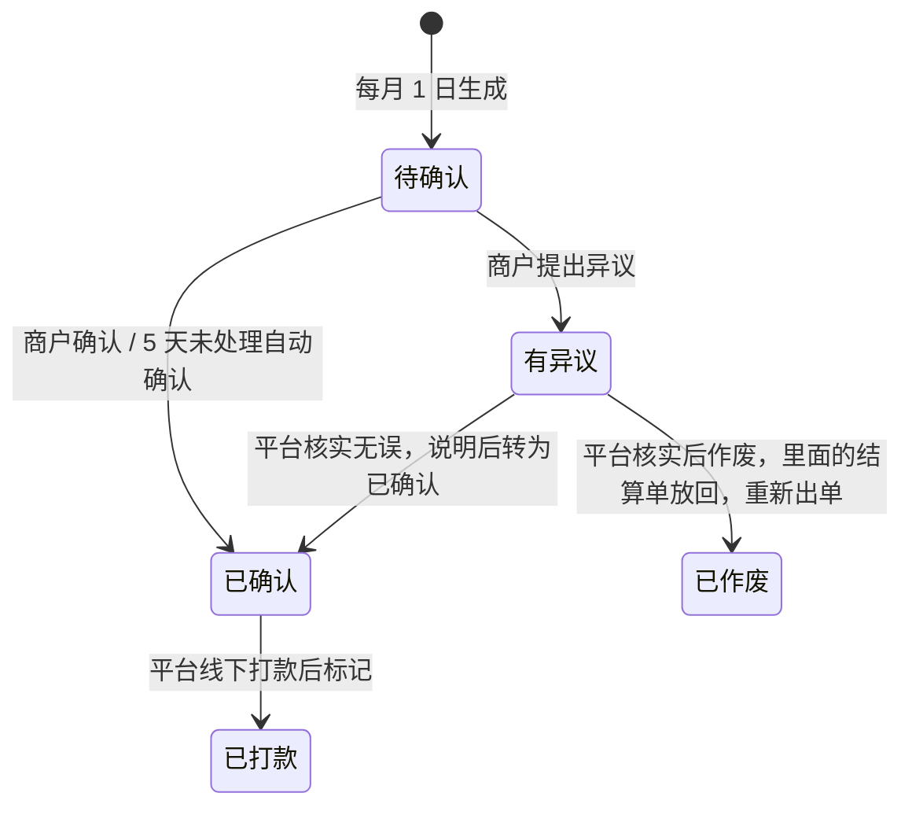

# 联盟券结算 · 结算账户与月度对账单（设计补充）

> **状态：已在分支 `feat/alliance-vouchers` 实现（迁移 V57），未合并、未上线。** 发票暂不做，等财务确认（§8 第 6 项）。
> 后端由 `AllianceVoucherIntegrationTest` 覆盖生成、确认、异议、作废重出、自动确认、账号加密和审计；页面还没在浏览器里走查过。
> 文中「待定」的地方见 §8，由业务和财务确认后再写代码。

## 1. 为什么要补

联盟券的钱是**平台买下兑换名额后付给供券商户**，属于企业采购付款：商户是卖方，平台是买方，
线下公对公打款本身没问题。但一期现在只有「一张券一条结算单、运营逐条标记已结算」，实际跑起来有两个硬缺口：

| 缺口 | 后果 |
|---|---|
| 没有收集商户的收款账户 | 运营不知道钱打到哪 |
| 没有按月汇总 | 一个商户一个月几十张券，运营要逐条标记，同一个流水号填几十遍，容易漏、容易错 |

这次补两样：**结算账户**和**月度对账单**。发票、通知、回单附件、自动打款放到后面（§9）。

## 2. 补完后的流程

```
供券商户                                   平台运营
────────                                   ────────
① 在「供券管理 → 结算账户」填对公账户  ──→  核对户名是否等于入驻主体 → 核对通过
                                               │
   （日常：门店核销，结算单进入申诉期……）       │
                                               ▼
                               每月 1 日：自动给每个商户生成上月对账单
                               （只收「申诉期已满、没有申诉」的结算单）
                                               │
② 查看对账单明细 → 确认无误                ←──┘
   （有异议可以提出；5 天不处理视为确认）
                                               │
                                               ▼
                               ③ 按对账单上的账户线下公对公打款
                                  后台对这张对账单点「标记已打款」，填流水号和打款日期
                                               │
④ 对账单和里面每一条结算单都变成「已结算」 ←──┘
```

**关键点：**

- **对账单只收申诉期已满的结算单**，所以进了对账单的钱不会再因为申诉被撤回。申诉中、申诉期内的，自动留到下个月。
- **打款以对账单为单位**，一次标记，里面的结算单全部变成已结算。不再支持逐条标记，避免两套口径。
- **对账单确认时，把当时的收款账户抄一份到对账单上。** 之后商户改账户，不影响这张对账单打到哪，防止中途被改账户截款。

## 3. 结算账户

### 3.1 填什么

| 字段 | 说明 |
|---|---|
| 账户类型 | 对公账户（一期建议只支持对公，见 §8 待定 1） |
| 户名 | 必须与入驻时的「主体名称」一致，平台核对 |
| 开户银行、开户支行 | 文字填写 |
| 银行账号 | **加密存储**；商户和平台列表里只显示后 4 位 |
| 财务联系人、电话 | 对账有问题时找谁 |

### 3.2 规则

- 只有商户管理员能填写和修改。
- 一个商户一个结算账户。
- 新填或修改后状态为「待核对」，平台核对通过后变成「已核对」，驳回需要写原因。
- **修改已核对的账户，要重新核对。** 核对完成前，商户不能确认新的对账单；已经确认的对账单仍按确认时抄下的账户打款。
- 平台查看完整账号时，必须写明用途，并留下审计记录（沿用平台管理里「查看完整信用代码」的做法）。
- **什么时候必须填，见 §8 待定 2。** 我的建议是：提交第一张供券单前必须填好，平台审核供券单时一并核对账户。

## 4. 月度对账单

### 4.1 怎么生成

- **每月 1 日凌晨**（北京时间），给每个供券商户生成上个月的对账单。实现上每天凌晨 2:30 都检查一次，上个月已有对账单就跳过，这样 1 日没跑成，第二天会补上。
- 收进来的是：截至上月最后一天，**申诉期已满、没冻结、还没进过任何对账单**的结算单。
- 这个商户上月没有符合条件的结算单，就不生成。
- 运营也可以在后台对某个月手动补生成，重复生成不会出第二张。

### 4.2 对账单的状态



- **确认时把收款账户抄到对账单上。** 确认那一刻账户必须是「已核对」，否则提示商户先完善账户。
- **作废的对账单**里的结算单回到「待结算」，可以进入重新生成的那张对账单。
- **标记已打款**时，运营要填流水号和实际打款日期；对账单和里面每条结算单在同一个事务里变成「已结算」。

### 4.3 商户看到什么

- 每张对账单：月份、结算单条数、面值合计、结算金额合计、收款账户（后 4 位）、状态、打款日期、流水号。
- 点开是明细：每一条是哪张券、什么商品、哪天核销、约定折扣、结算金额。

## 5. 对现有一期的改动

| 现在 | 改成 |
|---|---|
| 运营逐条「标记已结算」 | 去掉，改为按对账单标记已打款 |
| 结算单状态：申诉期 / 申诉处理中 / 待结算 / 已结算 / 已作废 | 增加「已入对账单」，表示已经汇总进某张对账单、等确认或打款 |
| 规则页「结算按月线下打款」 | 写清楚：每月 1 日出对账单 → 你确认 → 平台打款（打款时限见 §8 待定 4） |

## 6. 系统设计

### 6.1 跨商户与事务

对账单、结算账户、结算单都属于**供券商户自己的租户**，生成、确认、标记打款都只动一家商户的数据，
可以放在一个事务里完成，不需要像领券那样拆步骤。平台运营沿用现有方式，按商户逐个切进去读写。

### 6.2 生成方式

沿用仓库约定：`@Scheduled` 每月 1 日只负责逐个商户登记任务，幂等键 `alliance-statement:{商户}:{yyyy-MM}`；
`TaskHandler` 在该商户的租户里汇总生成。对账单表对（商户, 月份）加唯一约束（作废的除外），重复执行也只有一张。
「5 天未处理自动确认」也由同一个定时任务登记。

### 6.3 数据表（一个新的 Flyway 版本，编号实现时再登记）

| 表 | 属于 | 主要字段 |
|---|---|---|
| `alliance_settlement_accounts` 结算账户 | 供券方 | 商户（唯一）、账户类型、户名、开户行、支行、**账号密文**、账号后 4 位、财务联系人和电话、状态（待核对 / 已核对 / 已驳回）、核对意见、核对人、核对时间、版本号 |
| `alliance_statements` 对账单 | 供券方 | 商户、月份、条数、面值合计、结算合计、状态、确认人和时间（自动确认记为系统）、异议说明、**收款账户快照**（户名、开户行、支行、账号密文、后 4 位）、流水号、打款日期、标记人、标记时间 |
| `alliance_settlements` 加字段 | 供券方 | 所属对账单（可空） |

两张新表都按租户行级隔离。账号用现有的 `RealNameCrypto`（AES-256-GCM，密钥只在服务端）加密，
附加数据带上商户号和用途，换一家商户的密文解不开。这需要 `community` 模块负责人同意对外提供加密方法；
不同意的话，联盟券模块单独配一把密钥。查看完整账号的审计，建议复用平台管理的审计表，同样需要 `community` 负责人同意。

### 6.4 接口

**供券商户（管理员）：**

| 方法 | 路径 | 用途 |
|---|---|---|
| GET / PUT | `/api/alliance/settlement-account` | 查看（账号只给后 4 位）/ 填写或修改结算账户 |
| GET | `/api/alliance/statements` | 我的对账单列表 |
| GET | `/api/alliance/statements/{id}` | 对账单明细 |
| POST | `/api/alliance/statements/{id}/confirm` | 确认 |
| POST | `/api/alliance/statements/{id}/objection` | 提出异议（写原因） |

**平台运营：**

| 方法 | 路径 | 用途 |
|---|---|---|
| GET | `/api/platform/alliance/accounts` | 待核对的结算账户 |
| POST | `/api/platform/tenants/{tenantId}/alliance/settlement-account/review` | 核对通过 / 驳回 |
| POST | `/api/platform/tenants/{tenantId}/alliance/settlement-account/reveal` | 查看完整账号（写用途，留审计） |
| GET | `/api/platform/alliance/statements` | 对账单列表，可按状态和月份筛 |
| POST | `/api/platform/tenants/{tenantId}/alliance/statements/{id}/paid` | 标记已打款（流水号、打款日期） |
| POST | `/api/platform/tenants/{tenantId}/alliance/statements/{id}/void` | 处理异议：作废并放回结算单 |
| POST | `/api/platform/tenants/{tenantId}/alliance/statements/{id}/resolve` | 处理异议：核实无误，转为已确认 |
| POST | `/api/platform/alliance/statements/generate` | 手动补生成某个月 |

去掉一期的 `POST /api/platform/tenants/{tenantId}/alliance/settlements/{id}/paid`。

### 6.5 页面

| 页面 | 改动 |
|---|---|
| 供券管理 | 标签页变成：供券单 / 结算明细 / **对账单** / **结算账户** |
| 管理后台 → 联盟券 | 「结算」标签页改成：**结算账户核对**、**对账单**（待确认 / 有异议 / 待打款 / 已打款）；标记已打款在对账单上点 |
| 联盟券规则 | 「结算」一段改写成月度对账流程 |

## 7. 验收要覆盖的情况

- 月初生成：只收申诉期已满、没冻结、没进过对账单的结算单；申诉中的留到下月。
- 同一个商户同一个月重复生成（定时任务重跑、运营手动点）：只有一张。
- 账户未核对时：商户确认被拒绝并提示完善账户。
- 确认后商户修改账户：这张对账单仍按确认时的账户显示和打款。
- 5 天未处理自动确认；有异议的不会被自动确认。
- 异议作废：结算单放回，重新生成的对账单能收进来。
- 标记已打款：对账单和每条结算单一起变成已结算；没确认的对账单不能标记。
- 账号在数据库里是密文；商户、平台列表只看到后 4 位；查看完整账号留下审计记录。
- 行级安全：商户看不到别家的账户和对账单。

## 8. 待定事项与结论

2026-10-20：第 1–5 项按下表建议实施，第 6 项（发票）等财务确认，暂不做。

| # | 事项 | 我的建议 |
|---|---|---|
| 1 | 个体户没有对公账户怎么办，是否允许用经营者本人的个人账户 | 允许，但户名必须是营业执照上的经营者本人，平台核对。不允许任何第三人账户 |
| 2 | 结算账户什么时候必须填 | 提交第一张供券单前必须填；平台审核供券单时一并核对 |
| 3 | 商户多久不处理视为确认 | 5 天 |
| 4 | 确认后平台多少个工作日内打款，要不要写进规则页对外承诺 | 先内部定一个时限（例如 10 个工作日），跑顺了再写进规则 |
| 5 | 有没有最低打款金额 | 不设，有一笔就打 |
| 6 | **发票**：要不要商户先开发票、平台收到后再打款；发票抬头、税目怎么开 | 问财务。需要的话，在「已确认」和「已打款」之间加一个「待收发票」 |

## 9. 之后再做

- 发票管理（看 §8 待定 6 的结论）。
- ~~通知~~：站内通知已实现（2026-10-21，`notice` 模块、V58），对账单生成、自动确认、作废、核实、打款都会通知供券商户管理员。短信要等阿里云模板审核通过后，在 `NoticeService` 加发送渠道。
- 打款回单：上传银行回单图片，作为对账依据。
- 小额打款验证结算账户。
- 自动打款：量大以后，通过银企直连或持牌支付机构的企业付款接口打款。
