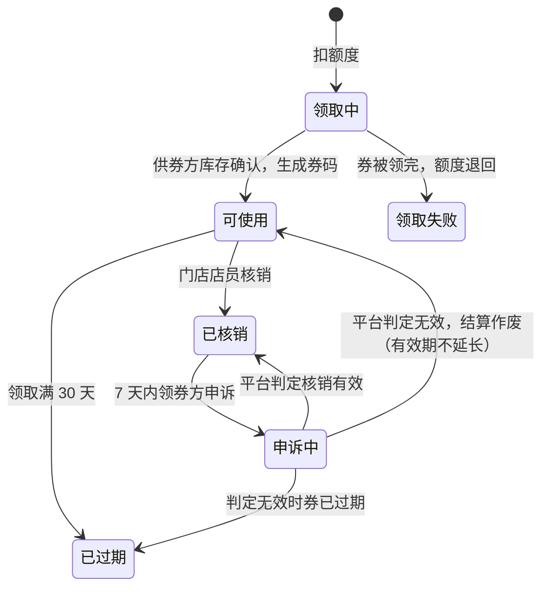
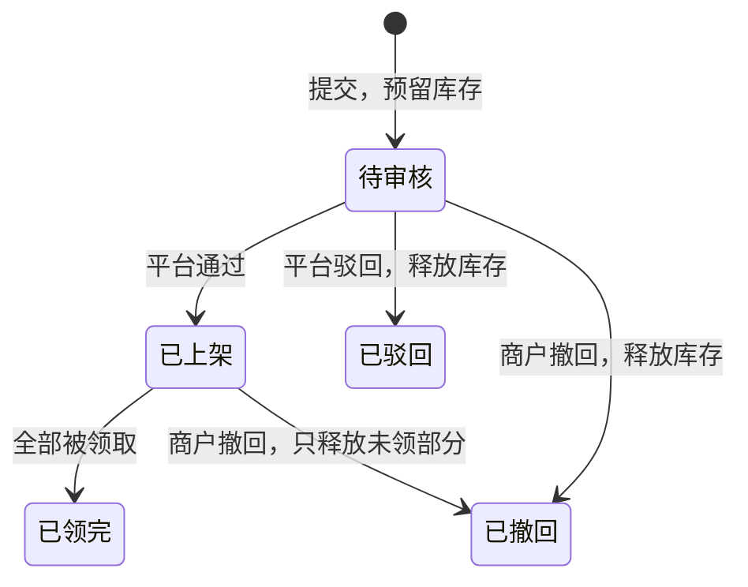

# 联盟券 · 设计稿

> **状态：一期已在分支 `feat/alliance-vouchers` 实现，未合并、未上线。**
> 后端流程由 `AllianceVoucherIntegrationTest` 在真实 PostgreSQL 上跑通（8 个场景，见 §10）；页面还没有在浏览器里走查过。
> 标「占位」的数字是起步值，上线前由业务确认；它们都是 `growth.alliance.*` 配置，页面通过 `GET /api/alliance/rules` 读取，不写死。
> 写作依据：远端 `main` 在 `a9d9073` 时的代码（会员套餐、烟火账本、门店、租户隔离）。
> 2026-10-20 修订：券改为到供券商户的线下门店核销。

## 1. 一句话

商户缴会员费后，平台送他一份**额度**。他用额度在券库里**领别家商户的商品兑换券**，
**凭券码到那家店的线下门店核销，当场拿到商品或服务。** 券的来源是：平台以折扣价向供券商户**买下这些兑换名额**，
但 **核销后、过了申诉期**才给供券商户结算。

## 2. 三个角色

| 角色 | 是谁 | 做什么 |
|---|---|---|
| 供券商户 | 已入驻、愿意让利换客流的商户（不强制） | 拿自家某个门店的某件商品出 N 张兑换券，在门店给持券人核销、交付，接受平台按折扣价结算 |
| 领券商户 | 缴了会员费的商户 | 用额度领券，到供券商户的门店出示券码使用 |
| 平台 | 一方志运营 | 审核供券、发放额度、处理申诉、对账结算 |

同一个商户可以同时是供券商户和领券商户，但**不能领自己（或同一营业执照主体）的券**。

## 3. 业务流程

```
供券商户 B                         平台                          领券商户 A
──────────                        ────                          ──────────
选本店一件商品，填供券数量 N  ──→  审核（定价、数量、主体）
（N 件库存先被预留）                 │ 通过
                                    ▼
                                 券库：B 门店的商品 × N 张
                                 （带门店名称、地址、营业时间）
                                    │
                                    │          缴会员费（方志 / 立传）
                                    │   ←──── 发放本期额度
                                    │
                                    │   ←──── 在领券中心挑 B 的券
                                    │         扣额度，拿到专属券码
                                    │
                                                到 B 的门店出示券码
店员扫码或输码 → 核对 → 核销  ←──────────────── （二维码 + 8 位数字码）
当场交付商品或服务
                                    │
                         核销成功 → 结算单进入 7 天申诉期
                         （期间 A 可申诉「没拿到商品」）
                                    │
B 收到结算款：面值 × 5 折  ←──  申诉期满，平台按月线下打款，标记已结
```

## 4. 业务规则

### 4.1 已经定下的

| 规则 | 内容 |
|---|---|
| 券的形态 | 绑定**某一件具体商品**的兑换券，1 张兑 1 件 |
| 用券方式 | 到供券商户的**线下门店**出示券码，由店员核销，当场交付；**不走网上下单和快递** |
| 在哪儿用 | 只能在该商品所属的那家门店核销；同一商户的其他门店也不行 |
| 券码 | 每张券一个专属码（二维码 + 8 位数字），只在领券商户自己的账号里显示；供券商户的任何页面和接口都看不到明文 |
| 结算时点 | 核销后进入 **7 天申诉期**，期满无申诉才可结算；平台不预付 |
| 领券方式 | 领券商户在券库自选，先到先得 |
| 供券 | 不强制，商户自愿 |
| 券有效期 | 领取后 30 天；已领到的券不受会员是否续费影响 |
| 额度周期 | 跟会员周期走，每期刷新，**不累积** |
| 未用的券 | 过期作废，预留的库存还给供券商户，平台不付钱 |
| 有券未用的商品和门店 | 商品不允许删除或停用，**门店也不允许关闭**，等券用完或过期 |
| 核销能否撤销 | 一期不允许。店员核错了，由领券商户申诉、平台处理 |

### 4.2 起步数字（占位，可调）

| 项 | 占位值 | 说明 |
|---|---|---|
| 结算折扣 | 面值的 **5 折** | 平台付给供券商户的比例 |
| 方志（¥299 / 30 天）额度 | 面值 **¥150** | 约会员费一半；套餐已送烟火，避免利润过薄 |
| 立传（¥699 / 30 天）额度 | 面值 **¥350** | 同上 |
| 同一供券商户的券，每人每期最多领 | **2 张** | 避免热门商户被一人领光 |
| 每个供券商户每月供券总面值 | ≤ **¥2000** | 控制平台结算敞口 |
| 单个商品供券数量 | ≤ 该商品库存的 **50%**；库存不限的商品 ≤ **20 件** | 留库存给正常顾客 |
| 申诉期 | 核销后 **7 天** | 期内结算冻结，领券商户可以申诉 |
| 核销输错次数 | 同一店员连续输错 **10 次**，暂停核销 **15 分钟** | 防止店员乱试券码 |

### 4.3 面值怎么定

面值等于**供券那一刻**的商品售价，随券锁定。商户之后改价，不影响已发出的券。
平台审核时看定价是否合理，防止商户先抬价再打折。

## 5. 钱怎么算

平台收入是会员费；平台成本是 **被核销且过了申诉期的券面值 × 5 折**；过期券没有成本。

| 场景（立传，额度 ¥350） | 平台收入 | 平台付给供券商户 | 差额 |
|---|---:|---:|---:|
| 额度全部领完并全部核销 | ¥699 | ¥175 | ¥524 |
| 领了 ¥350，只核销了 ¥200 | ¥699 | ¥100 | ¥599 |
| 一张没领 | ¥699 | ¥0 | ¥699 |

这里的差额**还没扣烟火赠送的成本**，最终利润要结合烟火成本算。

## 6. 状态流转

### 6.1 联盟券（领券商户这边）



「领取中」是跨商户的中间态，正常只持续一两秒。核销本身只在供券商户一侧完成，领券商户这边的「已核销」由后台任务同步，可能晚几秒显示。异常情况由补偿任务收尾，见 8.3。

### 6.2 供券单（供券商户这边）



已领出的券不受供券单撤回影响，供券商户必须照常 **在门店给持券人核销、交付**。

### 6.3 结算单

核销成功 → **申诉期**（7 天）→ **待结算** → 平台线下打款后标记 **已结算**。
申诉期内领券商户申诉、且平台判定核销无效 → **已作废**。

## 7. 风险与防线

| 风险 | 怎么发生 | 防线 |
|---|---|---|
| 套现 | 注册新商户，把券卖给平台换现金 | 只在核销且申诉期满后结算；供券需入驻审核通过；每月供券上限 |
| 左手倒右手 | 同一主体开两个商户互领互用 | 按统一社会信用代码去重，同主体不能领。线下核销没有物流痕迹，这条去重是主要防线 |
| 价格虚高 | 先抬价再打 5 折 | 面值随券锁定；平台审核定价 |
| 券不够发 | 供券商户少，会员领不到 | 额度写成「最多可领、以券库为准」；上线前先冷启动 10–20 家供券商户 |
| 有券没货 | 券发出后商户卖光了 | 供券时就预留库存；有券未用的商品不能删除或停用，门店不能关闭 |
| 虚假核销 | 供券商户没给货就自己核销，骗结算 | 券码只有领券商户能看到，供券方拿不到码就核销不了；核销后立即通知领券商户；7 天申诉期 |
| 店员猜码 | 店员乱输数字碰运气 | 8 位随机码；同一店员连续输错 10 次，暂停核销 15 分钟；所有尝试留记录 |
| 券码外泄 | 领券商户截图转给别人 | 码只在领券商户账号内显示；规则写明不得转售。线下无法完全拦住，二期考虑每分钟变化的动态码 |
| 离得太远用不上 | 领到的券在外地，去不了 | 券库卡片显示门店地址和营业时间，可按城市筛选；领取前提示「需到店使用」 |
| 核错券 | 店员核销了别人的券 | 核销前先显示商品名称和领券商户名称，店员确认后才核销 |

**合规提醒（不是法律意见，上线前请财务和法务确认）：**

- 收费后换成券，可能涉及预付式消费的监管要求。
- 会员费收入、向供券商户的折扣采购，都涉及发票和税务处理。
- **不要加「拉新商户得奖励」之类的机制。** 新商户让利补贴老商户，再叠加拉人奖励，容易被认定为传销性质。

## 8. 系统设计

### 8.1 模块与依赖

新建后端模块 `alliance`（按 `asset/` 的结构写），只通过公开 Service / DTO 调用其他模块：

| 依赖 | 用途 | 需要对方新增的东西 |
|---|---|---|
| `billing` | 会员开通时发额度；查会员状态 | 套餐加「联盟券额度」字段；开通会员时发事件（见 8.4） |
| `product` | 读商品、预留和释放库存 | 预留 / 释放供券库存的方法；「有券未用不能删除或停用」的拦截接口 |
| `store` | 门店名称、地址、营业时间；校验店员有没有这家门店的权限 | 「有券未用不能关店」：实现现有的 `StoreClosureGuard`；店员权限复用 `StoreAccessService` |
| `community` | 查入驻审核结果和信用代码 | 按商户查「是否已通过审核」和信用代码的只读方法 |

到店核销不生成网上订单，因此不依赖订单模块（`commerce`）。`billing`、`product`、`store` 的改动需要各自负责人同意。

### 8.2 关键约束：一个事务只属于一家商户

`TenantConnectionProvider` 在取出数据库连接时写入 `app.tenant_id`，行级安全按它过滤。
所以**一个事务里只能读写一家商户的数据**。领券、核销后的状态同步、过期和申诉都要同时动 A 和 B 两家商户，
必须拆成几步，每步用稳定的幂等键（联盟券编号 `voucher_ref`），中间失败由补偿任务收尾。

### 8.3 跨商户流程

**领券：**

1. A 的事务：锁住 A 本期额度，扣面值，写联盟券（状态「领取中」，生成 `voucher_ref` 和 8 位券码，明文只存在 A 这边），
   同时登记一个收尾任务。券码在这一步生成，是为了第 3 步万一没走完，收尾任务还能从 A 这边重新拿到它。
2. B 的事务：先锁 B 的供券单，再查这张券是否已领过（请求和收尾任务可能同时走到这里），剩余数减 1，
   写一条领取记录（`voucher_ref` 唯一），只存**券码的哈希**和**到期时间**。剩余为 0 时失败。
   券码哈希极小概率撞上 B 已有的券码，按领取失败处理，额度退回。
3. A 的事务：成功则券改「可使用」，到期时间为领取后 30 天；第 2 步失败则券改「领取失败」，额度退回。

**到店核销：**

1. B 的事务（店员登录后，在当前门店的核销页扫码或输码）：按券码哈希，在 B 自己的领取记录里查找。
   校验四件事：状态为「已领取」、未过期、券属于当前门店、店员有这家门店的权限。
   通过后先返回商品名称和领券商户名称，给店员核对。
2. 店员确认后，再开一个 B 的事务：锁住领取记录并重新校验，改为「已核销」，记下核销门店、店员和时间。
   同时生成结算单，状态「申诉期」，可结算时间为核销后 7 天。
3. A 的事务（由任务异步完成）：券改「已核销」，通知领券商户。

核销是否成功、会不会重复，**只靠 B 一侧就能保证**（行锁加状态检查）。A 一侧只是同步显示，晚几秒没有关系。

**过期：**
B 的领取记录自带到期时间。到期后，由任务在 B 一侧把记录改「已过期」，并把那 1 件库存还给商品；
再到 A 一侧，把券改「已过期」。

**申诉：**

1. A 的事务：券为「已核销」且在 7 天内，改「申诉中」，记下理由。
2. B 的事务（任务）：结算单冻结。
3. 平台处理后，两边各自更新：核销有效，则结算单回到正常流程；核销无效，则结算单「已作废」，券按 6.1 恢复或作废。

**补偿：** 后台定时任务只负责找出需要收尾的记录，然后提交 `tasks` 表任务：
卡在「领取中」超过 5 分钟的券、B 侧已核销或已过期但 A 侧还没同步的记录、到期未处理的券。
`TaskHandler` 用 `voucher_ref` 到另一家商户核对实际结果，再收尾。
这遵守仓库约定：`@Scheduled` 不直接改业务数据；`TaskHandler` 按至少一次执行设计。

### 8.4 与会员开通的衔接

`BillingService.fulfil` 在会员订单入账时，发出一个「会员已开通」事件，内容为：
商户、账单订单号、套餐快照、本期起止时间。

- 联盟券模块在**同一事务**里同步处理这个事件，写一条额度记录。账单订单号唯一，重复事件不会重复发额度。
- 提前续费时，新一期的起点是旧的到期日；新额度要到那天才可用，以符合「不累积」。
- 额度数值建议加在套餐上（`billing_plans` 新增「联盟券额度」列，并进入 `PlanSnapshot`）。
  这样和「赠送烟火」在同一处配置、随订单快照锁定。

### 8.5 数据表（一个 Flyway 版本，编号合并前登记）

金额统一用「分」存，和 `billing` 的 `price_minor` 一致。每张表都要
`ENABLE / FORCE ROW LEVEL SECURITY` + `tenant_isolation` 策略。

| 表 | 属于哪家商户 | 主要字段 |
|---|---|---|
| `alliance_offers` 供券单 | 供券方 B | 门店、商品、商品名快照、门店名称 / 地址 / 营业时间快照、面值、结算比例（万分比，占位 5000）、结算金额、供券数、已领数、状态、审核人和意见、版本号 |
| `alliance_offer_claims` 领取记录 | 供券方 B | 供券单、`voucher_ref`（唯一）、领券方商户号和名称、券码哈希（本商户内唯一）、到期时间、状态（已领取 / 已核销 / 已过期）、核销门店、核销店员、核销时间 |
| `alliance_redeem_attempts` 核销尝试 | 供券方 B | 店员、门店、时间、是否成功；用于「连续输错 10 次暂停」和事后追查 |
| `alliance_quota_grants` 额度 | 领券方 A | 账单订单号（唯一）、套餐代码、额度、已用、生效时间、失效时间 |
| `alliance_vouchers` 联盟券 | 领券方 A | `voucher_ref`（主键）、额度记录、供券方商户号 / 门店 / 供券单、商品和面值快照、券码明文、状态（按 6.1）、领取时间、到期时间、核销时间、申诉理由和结果 |
| `alliance_settlements` 结算单 | 供券方 B | 领取记录（唯一）、面值、结算金额、状态（申诉期 / 待结算 / 已结算 / 已作废）、可结算时间、是否冻结、打款流水号、确认人、结算时间 |

**额外的可见性策略：** `alliance_offers` 增加一条只读策略，让任意商户能看到「已上架且有剩余」的供券单，
写法参照 V50 的 `public_published_products`。其余表只能本商户自己看；平台运营沿用平台管理的方式，
按商户逐个切进去读取。

### 8.6 接口

所有接口的商户身份只从 JWT 取，返回统一用 `ApiResponse.ok(...)`。

**通用：** `GET /api/alliance/rules` 返回当前的结算比例、限领张数、供券上限、有效期和申诉期。

**供券商户：**

| 方法 | 路径 | 用途 |
|---|---|---|
| POST | `/api/alliance/offers` | 提交供券单（门店、商品、数量） |
| GET | `/api/alliance/offers` | 我的供券单和领用情况 |
| POST | `/api/alliance/offers/{id}/withdraw` | 撤回未领出的部分 |
| GET | `/api/alliance/settlements` | 我的结算单 |
| POST | `/api/stores/{storeId}/alliance-redemptions/preview` | 店员输入或扫入券码，返回商品名称、领券商户名称、到期时间，供核对；不改变任何状态 |
| POST | `/api/stores/{storeId}/alliance-redemptions` | 店员确认核销 |
| GET | `/api/stores/{storeId}/alliance-redemptions` | 这家门店的核销记录 |

**领券商户（需会员有效）：**

| 方法 | 路径 | 用途 |
|---|---|---|
| GET | `/api/alliance/quota` | 本期额度、已用、失效时间 |
| GET | `/api/alliance/pool` | 券库，支持分页、关键词、城市；自动排除自己和同主体的券 |
| POST | `/api/alliance/offers/{id}/claims` | 领一张券 |
| GET | `/api/alliance/vouchers` | 我的联盟券 |
| GET | `/api/alliance/vouchers/{ref}` | 单张券详情，含券码和门店地址（只有本商户能读到） |
| POST | `/api/alliance/vouchers/{ref}/dispute` | 核销后 7 天内申诉 |

**平台运营**（沿用 `/api/platform` 的运营身份校验）：

| 方法 | 路径 | 用途 |
|---|---|---|
| GET | `/api/platform/alliance/offers` | 待审核的供券单 |
| POST | `/api/platform/tenants/{tenantId}/alliance/offers/{id}/review` | 通过或驳回 |
| GET | `/api/platform/alliance/settlements` | 待结算和已结算列表 |
| POST | `/api/platform/tenants/{tenantId}/alliance/settlements/{id}/paid` | 线下打款后标记已结；申诉期内或冻结中的结算单不能标记 |
| GET | `/api/platform/alliance/disputes` | 待处理的申诉 |
| POST | `/api/platform/tenants/{tenantId}/alliance/vouchers/{ref}/dispute-resolution` | 判定核销有效或无效 |
| GET | `/api/platform/alliance/summary` | 已发放额度、已领面值、已核销、过期、待结、已结、待审供券、待处理申诉。会员费收入看计费后台，这里不重复统计 |

到店核销不生成网上订单，现有的订单接口和订单管理页**不受影响**。

### 8.7 页面

| 页面 | 位置 | 内容 |
|---|---|---|
| 领券中心 | 商户联盟页新增一栏（会员可见） | 本期额度进度条、券库卡片、「领取」按钮。卡片显示门店名称、地址、营业时间；可按城市筛选；领取前提示「需到店使用」 |
| 我的联盟券 | 商城分组新增 | 按状态分组。出示券码（二维码 + 8 位数字）、门店地址和电话、核销记录、申诉入口 |
| 供券管理 | 商城分组新增 | 从商品库选商品发起供券；看领用、核销和结算 |
| 门店核销 | 商城分组新增（店员可用） | 扫码或输码 → 核对商品和领券商户 → 确认核销；当天核销记录 |
| 平台后台 | 现有平台管理 | 供券审核、结算标记、汇总报表、申诉处理 |

商品库里已有的「团购券」只是直播讲解素材，与本功能无关。页面上统一叫「联盟券」，避免混淆。

## 9. 分两期

**一期（先跑通模式，不自动动钱）：**
额度发放、供券和审核、券库和领券、券码、门店核销、申诉、过期和补偿任务、
结算单生成、平台线下打款后手动标记、汇总报表。

**二期（看一期数据再做）：**
自动打款（例如微信支付分账）、开票、更细的主体关联识别、动态券码、按距离推荐门店、按数据调整额度和上限。

## 10. 验收要覆盖的情况

`AllianceVoucherIntegrationTest` 覆盖了下面各条，有三处要说明：「A 侧同步失败」只验证了同步任务能把状态补齐，
没有模拟任务失败后的重试；后台任务在测试里是直接调用处理器执行的，没有经过真实 worker 调度；
商户整体关闭时的拦截（`AllianceGuards.Accounts`）还没有测试。页面还没有走查。

- 两个商户同时领某供券单的最后一张：只有一个成功，另一个额度原样退回。
- 领券第 2 步后进程崩溃：补偿任务把券补成「可使用」，不重复扣库存。
- 同一张券，两个店员同时核销：只有一次成功。
- 别的门店（包括同一商户的其他门店）输入这个券码：查不到。
- 过期券、已核销的券再次核销：被拒绝，并说明原因。
- 同一店员连续输错 10 次：暂停核销 15 分钟。
- B 侧核销成功、A 侧同步失败：补偿任务补齐，领券商户看到「已核销」。
- 申诉期内或冻结中的结算单：平台不能标记已结；申诉判定无效后，结算作废，券按规则恢复或作废。
- 同一商户、同一信用代码主体领自己的券：被拒绝。
- 会员提前续费：新额度在新一期开始前不可用，旧额度到期作废。
- 券过期：状态变「已过期」，库存还给供券方，不生成结算。
- 有券未用的商品删除或停用、门店关闭：被拒绝，并提示原因。
- 行级安全：B 看不到 A 的额度和券列表，A 看不到 B 的结算单。
- B 的任何接口和页面都拿不到券码明文。

## 11. 还没定的事

| 事项 | 当前默认 | 谁来定 |
|---|---|---|
| 结算折扣 | 5 折（占位） | 业务 |
| 各套餐额度 | 方志 ¥150 / 立传 ¥350（占位） | 业务，结合烟火成本 |
| 能不能拿到店服务类商品供券（套餐、团购、服务） | 已按「允许」实现：供券只要求商品在售且售价大于 0，不要求线上上架 | 业务确认 |
| 申诉期多长 | 7 天（占位） | 业务 |
| 核销能否撤销 | 一期不允许，核错走申诉 | 业务 |
| 按城市筛选怎么做 | 一期按门店地址文字包含匹配（输入「嘉兴」能筛到地址里含嘉兴的门店）；要更准需要给门店补「城市」字段 | 业务 + `store` 负责人 |
| 会员退费时 | 未定。建议未领额度作废，已领的券照常有效 | 业务 + 财务 |
| 供券方是否必须入驻审核通过 | 是 | 业务 |
| 套餐额度存在套餐表还是联盟券模块 | 建议存在套餐表 | `billing` 负责人 |
| 合规（预付式消费、发票、税务） | 未评估 | 财务、法务 |
