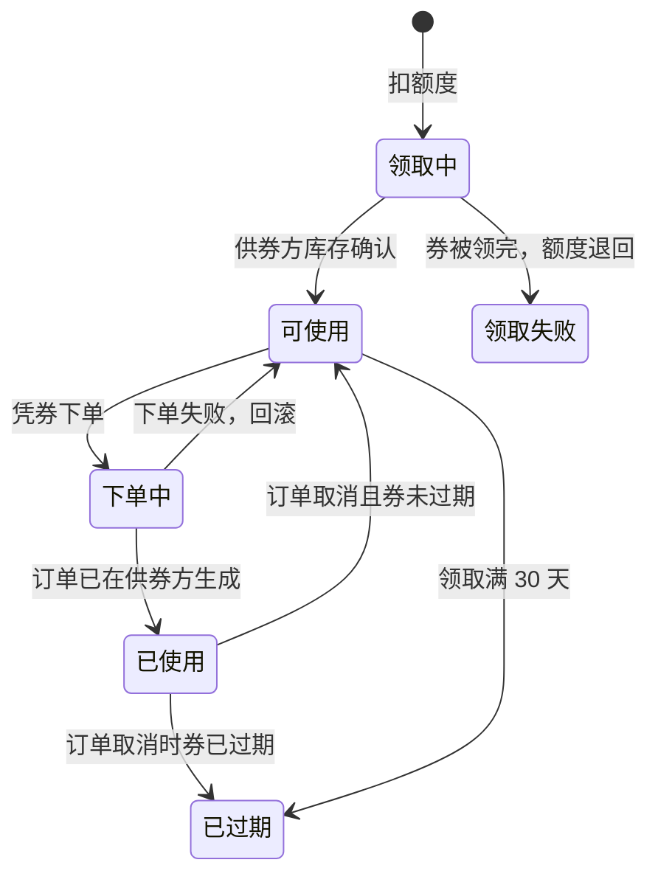
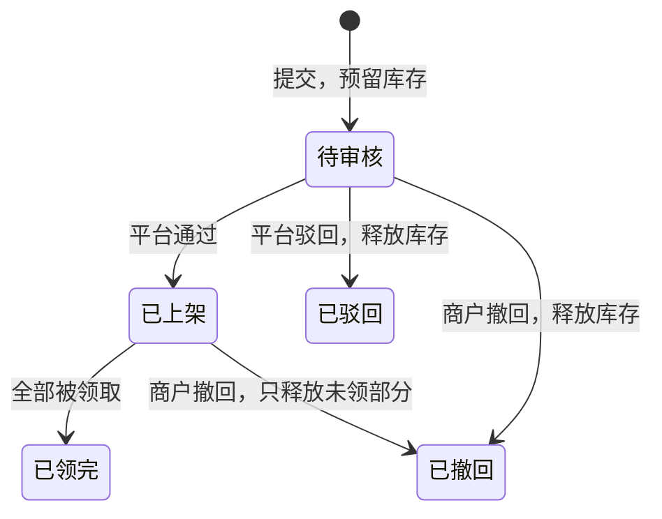

# 联盟券 · 设计稿

> **状态：设计稿，未实现，未经运行验证。** 文中的数据表、接口和页面都还没有写。
> 标「占位」的数字是起步值，上线前由业务确认。
> 写作依据：远端 `main` 在 `a9d9073` 时的代码（会员套餐、烟火账本、订单、租户隔离）。

## 1. 一句话

商户缴会员费后，平台送他一份**额度**。他用额度在券库里**领别家商户的商品兑换券**，
凭券到那家店下单、收货。券的来源是：平台以折扣价向供券商户**买下这些兑换名额**，
但**订单完成后**才给供券商户结算。

## 2. 三个角色

| 角色 | 是谁 | 做什么 |
|---|---|---|
| 供券商户 | 已入驻、愿意让利换客流的商户（不强制） | 拿自家某件实物商品出 N 张兑换券，接受平台按折扣价结算 |
| 领券商户 | 缴了会员费的商户 | 用额度领券，凭券下单收货 |
| 平台 | 一方志运营 | 审核供券、发放额度、对账结算 |

同一个商户可以同时是供券商户和领券商户，但**不能领自己（或同一营业执照主体）的券**。

## 3. 业务流程

```
供券商户 B                         平台                          领券商户 A
──────────                        ────                          ──────────
选一件已上架的实物商品
填供券数量 N                ──→  审核（定价、数量、主体）
（N 件库存先被预留）                 │ 通过
                                    ▼
                                 券库：B 的商品 × N 张
                                    │
                                    │          缴会员费（方志 / 立传）
                                    │   ←──── 发放本期额度
                                    │
                                    │   ←──── 在领券中心挑 B 的券
                                    │         扣额度，券进「我的联盟券」
                                    │
B 收到订单（金额 0，标「联盟券」） ←────────── 凭券下单，填收货信息
确认 → 发货                                    ↓
                                               确认收货（或发货 7 天后自动）
                                    │
                         订单完成 → 生成结算单：面值 × 5 折
                                    │
B 收到结算款              ←──  平台按月线下打款，标记已结
```

## 4. 业务规则

### 4.1 已经定下的

| 规则 | 内容 |
|---|---|
| 券的形态 | 绑定**某一件具体商品**的兑换券，1 张兑 1 件 |
| 结算时点 | 订单完成后才产生结算，平台不预付 |
| 领券方式 | 领券商户在券库自选，先到先得 |
| 供券 | 不强制，商户自愿 |
| 券有效期 | 领取后 30 天；已领到的券不受会员是否续费影响 |
| 额度周期 | 跟会员周期走，每期刷新，**不累积** |
| 未用的券 | 过期作废，预留的库存还给供券商户，平台不付钱 |
| 有券未用的商品 | 不允许下架或删除，等券用完或过期 |
| 用券订单取消 | 券退回给领券商户，**有效期不延长**；如已过期则作废 |

### 4.2 起步数字（占位，可调）

| 项 | 占位值 | 说明 |
|---|---|---|
| 结算折扣 | 面值的 **5 折** | 平台付给供券商户的比例 |
| 方志（¥299 / 30 天）额度 | 面值 **¥150** | 约会员费一半；套餐已送烟火，避免利润过薄 |
| 立传（¥699 / 30 天）额度 | 面值 **¥350** | 同上 |
| 同一供券商户的券，每人每期最多领 | **2 张** | 避免热门商户被一人领光 |
| 每个供券商户每月供券总面值 | ≤ **¥2000** | 控制平台结算敞口 |
| 单个商品供券数量 | ≤ 该商品库存的 **50%**；库存不限的商品 ≤ **20 件** | 留库存给正常顾客 |
| 自动确认收货 | 发货后 **7 天** | 防止领券商户一直不点确认 |

### 4.3 面值怎么定

面值等于**供券那一刻**的商品售价，随券锁定。商户之后改价，不影响已发出的券。
平台审核时看定价是否合理，防止商户先抬价再打折。

## 5. 钱怎么算

平台收入是会员费；平台成本是**被用掉的券面值 × 5 折**；过期券没有成本。

| 场景（立传，额度 ¥350） | 平台收入 | 平台付给供券商户 | 差额 |
|---|---:|---:|---:|
| 额度全部领完并用完 | ¥699 | ¥175 | ¥524 |
| 领了 ¥350，只用了 ¥200 | ¥699 | ¥100 | ¥599 |
| 一张没领 | ¥699 | ¥0 | ¥699 |

这里的差额**还没扣烟火赠送的成本**，最终利润要结合烟火成本算。

## 6. 状态流转

### 6.1 联盟券（领券商户这边）



「领取中」「下单中」是跨商户的中间态，正常只持续一两秒。异常卡住时由后台补偿任务收尾，见 8.3。

### 6.2 供券单（供券商户这边）



已领出的券不受供券单撤回影响，供券商户必须照常发货。

### 6.3 结算单

订单完成 → **待结算** → 平台线下打款后标记 **已结算**。订单在完成前被取消，不生成结算单。

## 7. 风险与防线

| 风险 | 怎么发生 | 防线 |
|---|---|---|
| 套现 | 注册新商户，把券卖给平台换现金 | 只在订单完成后结算；供券需入驻审核通过；每月供券上限 |
| 左手倒右手 | 同一主体开两个商户互领互用 | 按统一社会信用代码去重，同主体不能领 |
| 价格虚高 | 先抬价再打 5 折 | 面值随券锁定；平台审核定价 |
| 券不够发 | 供券商户少，会员领不到 | 额度写成「最多可领、以券库为准」；上线前先冷启动 10–20 家供券商户 |
| 有券没货 | 券发出后商户卖光了 | 供券时就预留库存；有券未用的商品不能下架 |
| 领券方不确认收货 | 拖着不点完成，供券商户拿不到钱 | 发货 7 天后自动完成 |
| 供券方不发货就点完成 | 想提前拿结算 | 用券订单的「完成」只能由领券方确认或自动完成，供券方不能直接点 |

**合规提醒（不是法律意见，上线前请财务和法务确认）：**

- 收费后换成券，可能涉及预付式消费的监管要求。
- 会员费收入、向供券商户的折扣采购，都涉及发票和税务处理。
- **不要加「拉新商户得奖励」之类的机制。** 新商户让利补贴老商户，再叠加拉人奖励，容易被认定为传销性质。

## 8. 系统设计

### 8.1 模块与依赖

新建后端模块 `alliance`（按 `asset/` 的结构写），只通过公开 Service / DTO 调用其他模块：

| 依赖 | 用途 | 需要对方新增的东西 |
|---|---|---|
| `billing` | 会员开通时发额度；查会员状态 | 套餐加「联盟券额度」字段；开通会员时发事件（见 8.4） |
| `product` | 读商品、预留和释放库存 | 预留 / 释放供券库存的方法；「有券未用不能下架」的拦截接口，写法参照 `store/StoreClosureGuard` |
| `commerce` | 用券下单、订单状态变化 | 订单支持「联盟券」支付方式；完成和取消时通知联盟券模块 |
| `community` | 查入驻审核结果和信用代码 | 按商户查「是否已通过审核」和信用代码的只读方法 |

`billing`、`product`、`commerce` 的改动需要各自负责人同意。

### 8.2 关键约束：一个事务只属于一家商户

`TenantConnectionProvider` 在取出数据库连接时写入 `app.tenant_id`，行级安全按它过滤。
所以**一个事务里只能读写一家商户的数据**。领券和用券都要同时动 A 和 B 两家商户，必须拆成几步，
每步用稳定的幂等键（联盟券编号 `voucher_ref`），中间失败由补偿任务收尾。

### 8.3 三条跨商户流程

**领券：**

1. A 的事务：锁住 A 本期额度，扣面值，写联盟券（状态「领取中」，生成 `voucher_ref`）。
2. B 的事务：锁住 B 的供券单，剩余数减 1，写一条领取记录（`voucher_ref` 唯一）。剩余为 0 时失败。
3. A 的事务：成功则券改「可使用」，到期时间为领取后 30 天；第 2 步失败则券改「领取失败」，额度退回。

**用券下单：**

1. A 的事务：锁券，确认「可使用」且未过期，改「下单中」。
2. B 的事务：生成订单，金额 0、支付方式「联盟券」，`voucher_ref` 唯一，所以重试只会拿到同一张订单。
   订单直接使用供券时预留的那 1 件库存，不再扣商品库存。
3. A 的事务：券改「已使用」，记下订单号。

**订单取消（B 操作）：**

1. B 的事务：订单改「已取消」，领取记录改回「已领取未使用」，库存仍留给这张券。
2. A 的事务：券未过期改回「可使用」，已过期则改「已过期」。改为已过期时，再到 B 释放那 1 件库存。

**补偿：** 后台定时任务只负责找出卡在「领取中」「下单中」超过 5 分钟的券，以及到期未处理的券，
然后提交 `tasks` 表任务。`TaskHandler` 用 `voucher_ref` 到另一家商户核对实际结果，再收尾。
这遵守仓库约定：`@Scheduled` 不直接改业务数据；`TaskHandler` 按至少一次执行设计。

### 8.4 与会员开通的衔接

`BillingService.fulfil` 在会员订单入账时，发出一个「会员已开通」事件，内容为：
商户、账单订单号、套餐快照、本期起止时间。

- 联盟券模块在**同一事务**里同步处理这个事件，写一条额度记录。账单订单号唯一，重复事件不会重复发额度。
- 提前续费时，新一期的起点是旧的到期日；新额度要到那天才可用，以符合「不累积」。
- 额度数值建议加在套餐上（`billing_plans` 新增「联盟券额度」列，并进入 `PlanSnapshot`）。
  这样和「赠送烟火」在同一处配置、随订单快照锁定。

### 8.5 数据表（一个 Flyway 版本，编号合并前登记）

金额统一用「分」存，和 `billing` 的 `price_minor` 一致。每张表都要
`ENABLE / FORCE ROW LEVEL SECURITY` + `tenant_isolation` 策略。

| 表 | 属于哪家商户 | 主要字段 |
|---|---|---|
| `alliance_offers` 供券单 | 供券方 B | 门店、商品、商品名快照、面值、结算比例（万分比，占位 5000）、结算金额、供券数、已领数、状态、审核人和意见、版本号 |
| `alliance_offer_claims` 领取记录 | 供券方 B | 供券单、`voucher_ref`（唯一）、领券方商户号、状态（已领取 / 已下单 / 已释放）、订单号 |
| `alliance_quota_grants` 额度 | 领券方 A | 账单订单号（唯一）、套餐代码、额度、已用、生效时间、失效时间 |
| `alliance_vouchers` 联盟券 | 领券方 A | `voucher_ref`（主键）、额度记录、供券方商户号 / 门店 / 供券单、商品和面值快照、状态、领取时间、到期时间、订单号 |
| `alliance_settlements` 结算单 | 供券方 B | 领取记录（唯一）、订单、面值、结算金额、状态（待结算 / 已结算）、打款流水号、确认人、结算时间 |

`merchant_orders` 新增：`payment_mode`（`NONE` / `ALLIANCE_VOUCHER`）、`voucher_ref`（可空、唯一）。

**额外的可见性策略：** `alliance_offers` 增加一条只读策略，让任意商户能看到「已上架且有剩余」的供券单，
写法参照 V50 的 `public_published_products`。其余四张表只能本商户自己看；平台运营沿用平台管理的方式，
按商户逐个切进去读取。

### 8.6 接口

所有接口的商户身份只从 JWT 取，返回统一用 `ApiResponse.ok(...)`。

**供券商户：**

| 方法 | 路径 | 用途 |
|---|---|---|
| POST | `/api/alliance/offers` | 提交供券单（门店、商品、数量） |
| GET | `/api/alliance/offers` | 我的供券单和领用情况 |
| POST | `/api/alliance/offers/{id}/withdraw` | 撤回未领出的部分 |
| GET | `/api/alliance/settlements` | 我的结算单 |

**领券商户（需会员有效）：**

| 方法 | 路径 | 用途 |
|---|---|---|
| GET | `/api/alliance/quota` | 本期额度、已用、失效时间 |
| GET | `/api/alliance/pool` | 券库，支持分页和关键词；自动排除自己和同主体的券 |
| POST | `/api/alliance/offers/{id}/claims` | 领一张券 |
| GET | `/api/alliance/vouchers` | 我的联盟券 |
| POST | `/api/alliance/vouchers/{ref}/redeem` | 凭券下单（填收货信息） |
| POST | `/api/alliance/vouchers/{ref}/confirm-receipt` | 确认收货，订单完成 |

**平台运营**（沿用 `/api/platform` 的运营身份校验）：

| 方法 | 路径 | 用途 |
|---|---|---|
| GET | `/api/platform/alliance/offers` | 待审核的供券单 |
| POST | `/api/platform/tenants/{tenantId}/alliance/offers/{id}/review` | 通过或驳回 |
| GET | `/api/platform/alliance/settlements` | 待结算和已结算列表 |
| POST | `/api/platform/tenants/{tenantId}/alliance/settlements/{id}/paid` | 线下打款后标记已结 |
| GET | `/api/platform/alliance/summary` | 会员费、发券面值、已用、过期、应结、已结 |

供券方 B 的发货沿用现有 `/api/stores/{storeId}/orders`。用券订单上，B 只能确认、发货、取消，**不能标记完成**。

### 8.7 页面

| 页面 | 位置 | 内容 |
|---|---|---|
| 领券中心 | 商户联盟页新增一栏（会员可见） | 本期额度进度条、券库卡片、「领取」按钮 |
| 我的联盟券 | 商城分组新增 | 按状态分组；凭券下单弹窗；确认收货 |
| 供券管理 | 商城分组新增 | 从商品库选商品发起供券；看领用和结算 |
| 订单管理 | 现有页面 | 用券订单显示「联盟券 · 平台结算 ¥x」标签 |
| 平台后台 | 现有平台管理 | 供券审核、结算标记、汇总报表 |

商品库里已有的「团购券」只是直播讲解素材，与本功能无关。页面上统一叫「联盟券」，避免混淆。

## 9. 分两期

**一期（先跑通模式，不自动动钱）：**
额度发放、供券和审核、券库和领券、凭券下单、确认收货和自动完成、过期和补偿任务、
结算单生成、平台线下打款后手动标记、汇总报表。

**二期（看一期数据再做）：**
自动打款（例如微信支付分账）、开票、更细的主体关联识别、按数据调整额度和上限。

## 10. 验收要覆盖的情况

- 两个商户同时领某供券单的最后一张：只有一个成功，另一个额度原样退回。
- 领券第 2 步后进程崩溃：补偿任务把券补成「可使用」，不重复扣库存。
- 用券第 2 步后进程崩溃：补偿任务找到已生成的订单，券改「已使用」，不会生成第二张订单。
- 同一商户、同一信用代码主体领自己的券：被拒绝。
- 会员提前续费：新额度在新一期开始前不可用，旧额度到期作废。
- 券过期：状态变「已过期」，库存还给供券方，不生成结算。
- 订单取消：券退回且有效期不变；已过期的券直接作废并释放库存。
- 有券未用的商品下架或删除：被拒绝，提示原因。
- 行级安全：B 看不到 A 的额度和券列表，A 看不到 B 的结算单。
- 供券方无法把用券订单直接标记为完成。

## 11. 还没定的事

| 事项 | 当前默认 | 谁来定 |
|---|---|---|
| 结算折扣 | 5 折（占位） | 业务 |
| 各套餐额度 | 方志 ¥150 / 立传 ¥350（占位） | 业务，结合烟火成本 |
| 运费谁出 | 未定。现订单不含运费，建议一期由供券方包邮并在供券时说明 | 业务 |
| 会员退费时 | 未定。建议未领额度作废，已领的券照常有效 | 业务 + 财务 |
| 供券方是否必须入驻审核通过 | 是 | 业务 |
| 套餐额度存在套餐表还是联盟券模块 | 建议存在套餐表 | `billing` 负责人 |
| 合规（预付式消费、发票、税务） | 未评估 | 财务、法务 |
