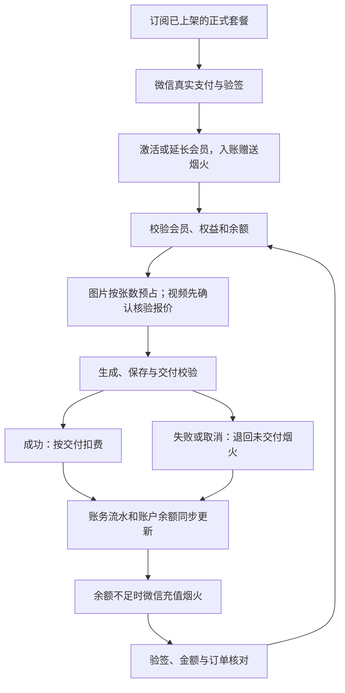

# 一方志 · 会员与烟火计费

版本：1.0 · 更新：2026-10-12 · 适用：`growth-api` 与 Vue 控制台。

生产账务使用 PostgreSQL，会员、支付订单、预占及烟火流水均由服务端维护。正式套餐和视频商业费率没有默认值，新账户余额为零。微信商户配置尚待补齐；未配置时，页面明确显示收款尚未开放，服务端拒绝创建支付订单。

## 业务规则

| 项目 | 当前规则 |
| --- | --- |
| 货币 | 烟火，整数单位 |
| 充值兑换 | 1 元 = 10 烟火；金额以人民币分存储 |
| 图片 | 每成功交付一张扣 3 烟火，包括重做、换版和文字修改 |
| 视频 | 必须先取得并确认服务端报价，再预占；交付后按实际用量结算 |
| 使用条件 | 会员有效，套餐开放对应图片或视频权益，且可用烟火足够 |
| 消耗顺序 | 会员赠送烟火优先，然后使用充值烟火 |
| 失败或取消 | 未交付部分释放预占；已交付的图片保留已扣费用 |
| 续订 | 有效期内可主动续订相同套餐标识，延长有效期并增加本次赠送烟火 |
| 换套餐 | 当前会员到期后订阅其他套餐 |
| 会员到期 | 暂停新创作和手动恢复；余额保留，已接受的生成继续交付结算 |
| 支付 | 微信 Native 扫码，一次性购买；续订由用户主动支付 |

赠送烟火尚未约定失效规则，本版保留余额，不自动清零。充值可在会员到期后办理，充值本身不会激活会员。账务归属商家账户（租户），同一商家的管理员与店员共享余额；管理员办理订阅和充值，店员可以查看余额、流水并使用已开放权益。

## 业务流程



图片先按请求数量预占 `张数 × 3`。规划模型返回数量不符时不执行生成；需要补充信息时释放预占。成功交付要求图片可从对象存储读取并通过解码；供应商临时 URL 不作为已交付作品。套图部分失败时，只扣已交付图片，失败图片可独立重试并重新预占 3 烟火。

视频完成供应商生成后，还需导入持久对象存储并通过媒体校验，才发布成片和扣费。取消、确认失败或执行中断释放未消耗烟火。恢复时重新确认费用；有可确认的原供应商任务就继续查询原任务，避免重复提交。无法确认上次是否提交的请求维持原有核对机制，不盲目再创建付费任务。

## 套餐与页面

`/billing` 显示实际可用烟火、赠送余额、充值余额、生成中预占、当前套餐、有效期和创作权益，以及真实支付订单和烟火明细。页面提供微信充值、已上架套餐订阅与同套餐续订。

侧栏左下方显示可用烟火、会员状态和生成中预占，并提供充值入口。接口失败时显示读取失败，不提供虚构余额。样式沿用一方志的宣纸底色、墨色文字、朱砂重点和本地中文字体。

套餐名称、价格、期限、赠送数与权益保持空目录，待正式商务信息确定后配置。将实际平台运营用户 ID 填入 `BILLING_OPERATOR_USER_IDS`（多个 ID 用逗号分隔），该用户在套餐页面可看到「套餐管理」：填写完整套餐、保存新版本、上架或下架。商家管理员不会自动获得平台运营权限。

订单保存购买时的套餐快照。修改商务条件应创建新版本并下架旧版本；已支付订阅保留原权益和期限，后续续订按所选新版本执行。前端无法指定订单金额、到账烟火或任意账户余额。

## 微信支付配置

配置前需要：

- 已开通 Native 支付的正式微信商户，以及与该商户绑定且支持支付的 AppID。
- 商户 API 证书序列号、对应 PKCS#8 PEM 私钥、32 字节 API v3 密钥。
- 微信支付公钥 ID 与 PEM 公钥，或已核实的平台证书及序列号。
- 可公网访问的 HTTPS 支付通知地址。

登录 `WECHAT_APP_ID` 与支付 `WECHAT_PAY_APP_ID` 分别配置，网站扫码登录的 AppID 不能直接假定支持支付。把环境变量写入服务器已有配置文件，私钥和 API v3 密钥不写入仓库。

| 环境变量 | 内容 |
| --- | --- |
| `BILLING_OPERATOR_USER_IDS` | 有套餐管理权限的真实平台用户 ID |
| `WECHAT_PAY_APP_ID` | 已绑定商户的支付 AppID |
| `WECHAT_PAY_MERCHANT_ID` | 微信商户号 |
| `WECHAT_PAY_MERCHANT_SERIAL` | 商户 API 证书序列号 |
| `WECHAT_PAY_PRIVATE_KEY_PATH` | 服务进程可读的商户私钥绝对路径 |
| `WECHAT_PAY_API_V3_KEY` | API v3 密钥，32 字节 |
| `WECHAT_PAY_PLATFORM_KEY_ID` | 对应公钥 ID 或平台证书序列号 |
| `WECHAT_PAY_PLATFORM_PUBLIC_KEY_PATH` | 平台公钥或证书 PEM 的绝对路径 |
| `WECHAT_PAY_NOTIFY_URL` | 例如 `https://yifangzhi.com/api/billing/wechat/notify` |
| `SPRING_CONFIG_ADDITIONAL_LOCATION` | 进程环境变量中的视频费率 YAML 路径，API 与全部 worker 一致；Spring 导入的 properties 文件用嵌套导入 |

Native 订单有效期 30 分钟。创建、查询、关单请求使用商户 RSA 签名；响应和回调均用配置的微信公钥验签，回调再执行 AES-GCM 解密。入账逐一核对 AppID、商户、订单、租户、人民币币种和金额。重复通知或主动查单只入账一次；全局支付流水唯一约束防止一笔收款被多订单使用。

支付前端每 4 秒主动查单，后台定时对账作为补偿。网络超时保留原本地订单和提交标识；已验证的远端 `ORDER_NOT_EXIST` 才允许恢复同一订单的下单。过期订单先查支付结果再关闭；取消操作若发现实际已支付，完成入账。代码不会以二维码展示、浏览器跳转或客户端声称支付成功作为到账依据。

现有配置以单个可信公钥 ID 验签，微信轮换公钥或平台证书时需同步更新文件和 ID。证书路径与费率文件必须对 API 和 worker 服务用户可读。

## 视频核验费率

当前供应商为 OnlyRouter，真实模型名由 `VIDEO_MODEL_*` 配置映射，接口为 `/v1/videos`。费率匹配完整供应商地址、实际模型名、分辨率、`t2v` / `v2v` 输入模式。没有唯一且有效的核验配置时，报价不可用，生成请求被拒绝。

核验时需要商户账户真实生效价格，不能直接把公开价格目录当作商户成本。公开模型目录 `https://onlyrouter.ai/api/models` 的视频价格以美元 / 百万视频 tokens 表示，并区分分辨率、输入模式与账户档位。内部已实现公式来源为相邻中转项目 `plugins/tasks/doubao/plugin.js`；在正式开放某个费率前，应再与当前供应商接口文档及该商户实际用量账单核对。

预占计算：

```text
预估 tokens = ceil(该分辨率核验的最大输出像素面积 × 计费帧率 × 计费秒数 / 面积除数)
预占烟火 = ceil(tokens / 1,000,000 × 美元单价 × 人民币汇率 × 售价倍率 × 10)
```

`max-output-pixels` 是该模型与分辨率所有已开放比例及 `auto` 的核验上界。报价说明是按该上界预占，不能把未经核验的宽高当作精确成本。帧率、面积除数、费率、汇率、倍率、视频参考是否计费均无商业默认值。V2V 需明确 `reference-video-billed`；若为 `true`，参考秒数来自服务端已探测素材，采用与供应商请求相同的 `max(1, floor(durationMs / 1000))`。

最终优先使用供应商返回的 `usage.completion_tokens`，其次 `usage.total_tokens`；未返回时使用交付视频的实测宽、高、时长与已核验公式计算。最终向上取整到整数烟火，最高为用户确认的预占额，超出部分由平台承担，多余预占退回。

报价标识绑定租户、提交标识、提示词、素材、模型、比例、分辨率、时长与完整费率。参数或费率变化后，旧报价不能用于新任务；首次调用供应商前再次核对供应商与报价有效期。已经提交的任务按接受时的费率快照结算。

### 外部配置文件

准备一个服务端 YAML 文件，下面是**禁用模板**：待核验字段保持 `null` / `0`，此状态无法报价或售卖。每个正式开放的模型、分辨率及输入模式分别配置一条，不得重复匹配键。

```yaml
growth:
  billing:
    video:
      rates:
        - provider-base-url: https://api.onlyrouter.ai
          provider-model: doubao-seedance-2-0-260128
          resolution: 720p
          video-input: t2v
          usd-per-million-tokens: null
          cny-per-usd: null
          selling-multiplier: null
          max-output-pixels: 0
          frames-per-second: 0
          token-area-divisor: 0
          reference-video-billed: null
          source-url: null
          verified-at: null
          valid-until: null
```

`source-url` 填实际核验依据的 HTTPS 地址，`verified-at` 与 `valid-until` 使用 ISO-8601 时间。到期未重新核验时停止接受新任务。API 与所有生成 worker 加载同一个 YAML 文件。

生产 systemd 使用 `--spring.config.import=file:/etc/wuyao/growth-api.env[.properties]`。商户变量可填在该 properties 文件中；费率文件通过该文件内的嵌套导入加载：

```properties
spring.config.import=file:/etc/wuyao/billing-rates.yml
```

`SPRING_CONFIG_ADDITIONAL_LOCATION` 只用于真正的进程环境变量（例如 Docker Compose），不在被 Spring 导入的 `.env` 文件中使用。配置文件导入不加 `optional:`，避免文件丢失时静默采用空费率。

Docker 部署把实际密钥、公钥和费率 YAML 放在私有目录，将 `BILLING_CONFIG_DIR` 指向该目录。Compose 为 API 和 worker 把目录只读挂载到 `/etc/wuyao`，因此 PEM 环境变量须填写容器内路径。模板目录 `deploy/billing-config/` 已忽略提交。

## 数据与恢复

Flyway `V47__yanhuo_billing.sql` 创建账户、套餐、订单、预占和不可变流水表，添加图片 / 视频扣费关联。账务表强制启用租户行级安全；修改余额先锁同一账户行，生成、取消、重试与交付使用相同锁顺序。预占、扣费和释放与创作状态在同一事务提交，事务回滚不留下扣费。

账务事件拥有唯一键，重复提交、重复交付、失败事件重放不会重复扣费或退款。任务终止后通过提交后事件释放烟火；每分钟的恢复任务重放未完成释放的失败或取消任务。Redis 并发许可在终态事务提交后释放，回滚仍保留原许可。

升级前正在生成的旧任务没有预占关联，允许完成原任务而不追溯扣费；用户手动恢复旧任务时，需要有效会员、费用确认和新预占。旧前端的演示会员与本地余额不导入生产数据库。仓库中的早期 `src/domain/billing.js` 仅供历史契约测试，生产界面使用 `src/stores/billing.js` 和 `/api/billing`。

当前实现覆盖会员购买、充值、图片与视频计费。退款 API、自动续费授权和发票业务需独立商务规则与微信官方流程，本版不提供自动推断处理。

## 接口与检查

| 接口 | 用途 |
| --- | --- |
| `GET /api/billing/summary` | 实际余额、会员、权益、收款可用状态 |
| `GET /api/billing/plans` | 已上架正式套餐 |
| `POST /api/billing/orders/subscription` | 购买或续订套餐 |
| `POST /api/billing/orders/topup` | 充值订单 |
| `GET /api/billing/orders/{id}` | 查询并对账支付状态 |
| `POST /api/billing/orders/{id}/cancel` | 查支付结果后关闭订单 |
| `GET /api/billing/orders` / `ledger` | 支付历史 / 烟火流水 |
| `POST /api/billing/wechat/notify` | 微信签名加密回调 |
| `/api/billing/operations/plans` | 运营套餐目录、新版本与上架管理 |
| `POST /api/video/quote` | 服务端视频报价 |
| `GET /api/video/workflows/{id}/retry-quote` | 恢复费用确认 |

本地验证命令（后端数据库集成测试需要可用 Docker 与 Java 21）：

```powershell
npm test
npm run typecheck
npm run lint
npm run build
Set-Location backend/growth-api
./mvnw.cmd test
```

自动测试中的套餐、余额、费率、证书密钥和供应商返回仅存在于 `src/test` 或前端测试中，生产配置和数据库迁移不插入它们。自动检查覆盖会员与权益拒绝、并发余额不足、幂等扣费、部分交付退款、重复支付、跨租户隔离、回滚、失败补偿、实际视频用量结算和微信签名解密。

2026-10-12 本地验证：前端 219 项测试通过，类型检查和构建通过，Lint 为 0 错误、235 项现有警告；Linux 后端全套 759 项测试中 756 项通过，3 项抽帧测试因容器未安装 FFmpeg 跳过。另行验证的 Spring 配置导入测试通过；基础数据库集成套件 99 项全部通过。Compose 配置校验及 `git diff --check` 通过。

正式启用需要补齐已确认套餐、微信商户文件与费率，然后发布同一版本的前端、API 和全部 worker，最后完成真实微信扫码支付、通知 / 查单、到账及一次生成交付的商户联调。当前工作仅完成本地代码和自动验证，没有在正式服务器启用收费或执行真实交易。

## 变更记录

- 2026-10-12：接入烟火账户、会员套餐、微信 Native、图片交付扣费、视频核验报价与实际结算、任务失败恢复及真实账户页面。
