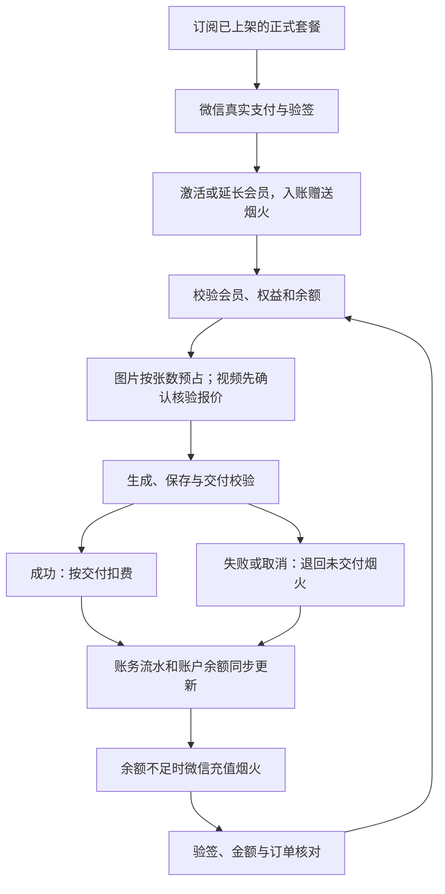

# 一方志 · 会员与烟火计费

版本：1.2 · 更新：2026-10-13 · 适用：`growth-api` 与 Vue 控制台。

生产账务使用 PostgreSQL，会员、支付订单、预占及烟火流水均由服务端维护。正式套餐和视频商业费率没有默认值，新账户余额为零。微信商户配置尚待补齐；未配置时，页面明确显示收款尚未开放，服务端拒绝创建支付订单。

## 业务规则

| 项目 | 当前规则 |
| --- | --- |
| 货币 | 烟火，整数单位 |
| 充值兑换 | 1 元 = 10 烟火；金额以人民币分存储 |
| 图片 | 每成功交付一张扣 3 烟火，包括重做、换版和文字修改 |
| 视频反推 | 每次成功分析扣 1 烟火，上传文件与链接导入使用相同价格 |
| 视频 | 必须先取得并确认服务端报价，再预占；交付后按实际用量结算 |
| 使用条件 | 已登录用户可以查看业务模块界面；提交创作、分析、上传及修改业务数据等操作需有效会员，图片与视频生成还需对应套餐权益及足够烟火 |
| 其他模块 | 正式单次价格待确定，不设置虚构费率 |
| 消耗顺序 | 会员赠送烟火优先，然后使用充值烟火 |
| 失败或取消 | 未交付部分释放预占；已交付的图片保留已扣费用 |
| 续订 | 有效期内可续订相同套餐标识，延长有效期并增加赠送烟火；购买新版本会立即更新当前权益 |
| 换套餐 | 当前会员到期后订阅其他套餐 |
| 会员到期 | 暂停新创作和手动恢复；余额保留，已接受的生成继续交付结算 |
| 支付 | 微信 Native 扫码，一次性购买；续订由用户主动支付 |

赠送烟火尚未约定失效规则，本版保留余额，不自动清零。充值可在会员到期后办理，充值本身不会激活会员。账务归属商家账户（租户），同一商家的管理员与店员共享余额；管理员办理订阅和充值，店员可以查看余额、流水并使用已开放权益。

供应商接受请求后的取消、超时与失败仍按现有规则释放未交付烟火，可能留下平台已支付的供应商成本。
退款结算、图片定价、续订上限等尚未拍板的规则见[计费待定业务事项](yanhuo-billing-decisions.md)。

业务模块页面对已登录用户保持可访问，非会员在提交创作、分析、上传等操作时提示“您还未开通会员”，并可前往「套餐与权益」。
业务 API 对读取请求保持可访问，对会创建任务、产生费用或修改业务数据的写请求校验会员。登录、订阅与充值、账户管理及帮助入口保持可访问；
桌面端也可访问会员页面，不因缺少门店而遮挡订阅入口。

## 业务流程



图片先按请求数量预占 `张数 × 3`。规划模型返回数量不符时不执行生成；需要补充信息时释放预占。成功交付要求图片可从对象存储读取并通过解码；供应商临时 URL 不作为已交付作品。套图部分失败时，只扣已交付图片，失败图片可独立重试并重新预占 3 烟火。

视频反推提交分析时预占 1 烟火，最终报告成功提交时扣除。失败、取消、重试耗尽或任务异常终止释放预占，
同一 `requestKey` 的并发与重复提交只产生一次分析和一次预占；重新分析使用新编号并另行计费。

视频完成供应商生成后，还需导入持久对象存储并通过媒体校验，才发布成片和扣费。取消、确认失败或执行中断释放未消耗烟火。恢复时重新确认费用；有可确认的原供应商任务就继续查询原任务，避免重复提交。无法确认上次是否提交的请求维持原有核对机制，不盲目再创建付费任务。

## 套餐与页面

`/billing` 显示实际可用烟火、赠送余额、充值余额、生成中预占、当前套餐、有效期和创作权益，以及真实支付订单和烟火明细。页面提供微信充值、已上架套餐订阅与同套餐续订。

侧栏左下方显示可用烟火、会员状态和生成中预占，并提供充值入口。接口失败时显示读取失败，不提供虚构余额。样式沿用一方志的宣纸底色、墨色文字、朱砂重点和本地中文字体。

套餐名称、价格、期限、赠送数与权益保持空目录，待正式商务信息确定后配置。将实际平台运营用户 ID 填入 `BILLING_OPERATOR_USER_IDS`（多个 ID 用逗号分隔），该用户在套餐页面可看到「套餐管理」：填写完整套餐、保存新版本、上架或下架。商家管理员不会自动获得平台运营权限。

订单保存购买时的套餐快照。修改商务条件应创建新版本，先下架旧版本再上架新版本；同一标识最多有一个上架版本。
套餐目录修改不会直接改动现有账户；账户购买同标识的新版本并支付成功时，当前权益立即整体切换到新版本，
原剩余期限再加本次购买期限。订单历史保留各次购买快照，当前实现没有按期限排队切换权益。
前端无法指定订单金额、到账烟火或任意账户余额。

充值区域在非会员或会员到期时明确提醒：充值不会激活会员，使用功能前须先订阅或续订。
烟火明细以 `可用变动 + 预占变动` 表示实际收支，预占及释放的收支为零，并另列预占变动；交付扣费才显示负收支。

## 微信支付配置

配置前需要：

- 已开通 Native 支付的正式微信商户，以及与该商户绑定且支持支付的 AppID。
- 商户 API 证书序列号、对应 PKCS#8 PEM 私钥、32 字节 API v3 密钥。
- 微信支付公钥 ID 与 PEM 公钥，或已核实的平台证书及序列号。
- 可公网访问的 HTTPS 支付通知地址。

登录 `WECHAT_APP_ID` 与支付 `WECHAT_PAY_APP_ID` 分别配置，网站扫码登录的 AppID 不能直接假定支持支付。把环境变量写入服务器已有配置文件，私钥和 API v3 密钥不写入仓库。

| 环境变量 | 内容 |
| --- | --- |
| `BILLING_OPERATOR_USER_IDS` | 有套餐管理权限的真实平台用户 ID |
| `WECHAT_PAY_APP_ID` | 已绑定商户的支付 AppID |
| `WECHAT_PAY_MERCHANT_ID` | 微信商户号 |
| `WECHAT_PAY_MERCHANT_SERIAL` | 商户 API 证书序列号 |
| `WECHAT_PAY_PRIVATE_KEY_PATH` | 服务进程可读的商户私钥绝对路径 |
| `WECHAT_PAY_API_V3_KEY` | API v3 密钥，32 字节 |
| `WECHAT_PAY_PLATFORM_KEY_ID` | 对应公钥 ID 或平台证书序列号 |
| `WECHAT_PAY_PLATFORM_PUBLIC_KEY_PATH` | 平台公钥或证书 PEM 的绝对路径 |
| `WECHAT_PAY_NOTIFY_URL` | 例如 `https://yifangzhi.com/api/billing/wechat/notify` |
| `SPRING_CONFIG_ADDITIONAL_LOCATION` | 进程环境变量中的视频费率 YAML 路径，API 与全部 worker 一致；Spring 导入的 properties 文件用嵌套导入 |

Native 订单有效期 30 分钟。创建、查询、关单请求使用商户 RSA 签名；响应和回调均用配置的微信公钥验签，回调再执行 AES-GCM 解密。入账逐一核对 AppID、商户、订单、租户、人民币币种和金额。重复通知或主动查单只入账一次；全局支付流水唯一约束防止一笔收款被多订单使用。

支付前端每 4 秒读取本地订单状态，不调用微信查单。用户主动刷新或恢复支付使用独立的刷新接口，
数据库限制同一订单的主动及后台查单至少间隔 30 秒；取消支付订单仍先查询真实支付结果。
支付通知负责及时入账，worker 每分钟对账作为补偿。网络超时保留原本地订单和提交标识；
已验证的远端 `ORDER_NOT_EXIST` 才允许恢复同一订单的下单。过期订单先查支付结果再关闭；
取消操作若发现实际已支付，完成入账。二维码展示、浏览器跳转或客户端声称支付成功不作为到账依据。

现有配置以单个可信公钥 ID 验签，微信轮换公钥或平台证书时需同步更新文件和 ID。证书路径与费率文件必须对 API 和 worker 服务用户可读。

`time_expire` 使用秒级 RFC 3339 时间和 `+08:00` 偏移，不发送数据库时间中的小数秒。
签名、验签及 AES-GCM 解密由当前网关实现，尚未接入微信官方 SDK；真实商户联调仍是正式收款前置条件。

## 支付宝配置

`BILLING_PAYMENT_METHOD=ALIPAY` 时使用支付宝电脑网站支付（`alipay.trade.page.pay`），同一时间只开一种收款方式。
接口加签方式为**公钥模式**（RSA2），不支持公钥证书模式。

配置前需要：

- 已签约电脑网站支付，且该产品绑定在「已上线」的开放平台应用上。
- 用支付宝开放平台密钥工具生成的应用私钥（PKCS8），对应应用公钥已上传到该应用的「开发设置 → 接口加签方式」。
- 同一页面的支付宝公钥。
- 可公网访问的 HTTPS 支付通知地址。

| 环境变量 | 内容 |
| --- | --- |
| `BILLING_PAYMENT_METHOD` | `ALIPAY` |
| `ALIPAY_GATEWAY` | 正式 `https://openapi.alipay.com/gateway.do`；沙箱 `https://openapi-sandbox.dl.alipaydev.com/gateway.do` |
| `ALIPAY_APP_ID` | 开放平台应用 APPID |
| `ALIPAY_SELLER_ID` | 商户 PID（`2088` 开头），通知中的 `seller_id` 必须与之一致 |
| `ALIPAY_PRIVATE_KEY_PATH` | 服务进程可读的应用私钥文件绝对路径；密钥工具导出的裸 Base64 或 PEM 均可 |
| `ALIPAY_PUBLIC_KEY_PATH` | 支付宝公钥文件绝对路径 |
| `ALIPAY_NOTIFY_URL` | 例如 `https://yifangzhi.com/api/billing/alipay/notify` |

正式与沙箱是两套 APPID、PID 和密钥，不能混用。

订单有效期 30 分钟，作为 `time_expire` 传给支付宝。收银台链接在用户点「前往支付宝付款」时由服务端现签，
不保存：支付宝拒绝过期的请求时间戳。页面在点击时先打开新窗口，再把签好的链接填进去，避免被浏览器拦截弹窗。

支付宝只在买家打开收银台后才建立交易，所以待支付订单查单得到已验签的 `ACQ.TRADE_NOT_EXIST` 是正常状态，
不重建订单；订单过期后才在本地关闭，远端已建立交易的先关单。取消订单同样先查真实支付结果。
查单与关单响应都按原始 JSON 文本验签；通知按排序参数验签，并核对 APPID、PID、订单号、金额和
`TRADE_SUCCESS`/`TRADE_FINISHED` 状态，`passback_params` 携带租户与订单号。入账流水为 `alipay:<trade_no>`，
与微信共享全局唯一约束。签名与验签由当前网关实现，未接入支付宝官方 SDK。

2026-10-20 沙箱联调（本机）：1 元充值订单的收银台被沙箱网关接受；付款前查单得到已验签的
`ACQ.TRADE_NOT_EXIST`；沙箱买家付款后，主动查单验签通过并入账 10 烟火，重复查单不重复入账。
**未验证**：异步通知（本机收不到回调，须在服务器上用正式参数验证）；「前往支付宝付款」在真实 Chrome 中
打开新窗口（桌面应用内置浏览器的新窗口未能加载）；正式环境收款。

### 人工收款通道

默认收款方式为 `WECHAT`。人工通道仅在服务端显式配置 `MANUAL`、非空运营白名单、实际收款主体，
以及收款账号或二维码后开放；它不使用微信 API，也不会自动识别转账到账。
在已导入的 Spring properties 文件中填写实际值，例如：

```properties
growth.billing.payment-method=MANUAL
growth.billing.payment-recipient=实际收款主体
growth.billing.payment-account=实际收款账号
growth.billing.payment-bank=实际开户行
growth.billing.payment-instructions=付款后请向客服提供订单号和付款回单
```

`BILLING_OPERATOR_USER_IDS` 仍填写实际运营用户 ID。可选的
`growth.billing.payment-qr-code-url` 用于展示收款方提供的二维码，人工订单有效期为 7 天。
页面展示收款信息，运营核实真实入账后调用人工核销接口；回单编号、金额、订单状态、有效期和运营权限均须通过校验。
同一回单在所有租户间只能核销一次，微信和支付宝订单不能走人工核销。

## 视频核验费率

当前视频网关默认供应商为 Haomaotoken，真实模型名由 `VIDEO_MODEL_*` 配置映射，接口为 `/api/v3/contents/generations/tasks`。费率匹配完整供应商地址、实际模型名、分辨率、`t2v` / `v2v` 输入模式。没有唯一且有效的核验配置时，报价不可用，生成请求被拒绝。切换接口不会自动迁移或启用旧供应商费率。

当前模式由是否存在参考视频决定：纯文字和仅带参考图片都匹配 `t2v`，带参考视频才匹配 `v2v`。
这说明内部报价匹配方式，不能据此假定参考图片没有供应商成本；正式费率须覆盖对应输入的实际账单。

Seedance 2.0 的 8 个 USD / 1M token 档位已按运营提供的价格表整理在
[费率模板](seedance-2.0-rates.template.yml) 中：480p、720p、1080p、4K 各有无参考视频两档。
模板故意保持汇率、售价倍率、token 估算公式和核验期限为空或为零，因此复制后仍不会开放售卖；完成真实账单核验并补齐这些字段后，才可放入私有的
`billing-rates.yml`。这张价格表本身不能推出人民币售价，也不能推出每个视频的 token 数量。

当前开发机已放入试算费率 `backend/growth-api/billing-rates.local.yml`：美元汇率为 `6.85`，售价倍率为 `1.0`，
即按截图价格换算后不加价。它同时覆盖当前本地配置的 OnlyRouter 模型和 Haomaotoken 模型，方便切换供应商做对照；完成试算后应替换为私有配置，不要提交或长期使用这份本地文件。

核验时需要商户账户真实生效价格，不能直接把公开价格目录当作商户成本。Haomaotoken 的公开目录 `https://haomaotoken.com/api/pricing` 包含模型、输入模式、分辨率的计价表达式和分组折扣，需核对每个模型实际使用的令牌分组及账单。现有 tokens 公式来源为之前中转项目 `plugins/tasks/doubao/plugin.js`；在正式开放某个费率前，应再与当前供应商接口文档及该商户实际用量账单核对。

预占计算：

```text
预估 tokens = ceil(该分辨率核验的最大输出像素面积 × 计费帧率 × 计费秒数 / 面积除数)
预占烟火 = ceil(tokens / 1,000,000 × 美元单价 × 人民币汇率 × 售价倍率 × 10)
```

`max-output-pixels` 是该模型与分辨率所有已开放比例及 `auto` 的核验上界。报价说明是按该上界预占，不能把未经核验的宽高当作精确成本。帧率、面积除数、费率、汇率、倍率、视频参考是否计费均无商业默认值。V2V 需明确 `reference-video-billed`；若为 `true`，参考秒数来自服务端已探测素材，采用与供应商请求相同的 `max(1, floor(durationMs / 1000))`。

最终优先使用供应商返回的 `usage.completion_tokens`，其次 `usage.total_tokens`；未返回时使用交付视频的实测宽、高、时长与已核验公式计算。最终向上取整到整数烟火，最高为用户确认的预占额，超出部分由平台承担，多余预占退回。

报价标识绑定租户、提交标识、提示词、素材、模型、比例、分辨率、时长与完整费率。参数或费率变化后，旧报价不能用于新任务；首次调用供应商前再次核对供应商与报价有效期。已经提交的任务按接受时的费率快照结算。

### 外部配置文件

准备一个服务端 YAML 文件，下面是**禁用模板**：待核验字段保持 `null` / `0`，此状态无法报价或售卖。每个正式开放的模型、分辨率及输入模式分别配置一条，不得重复匹配键。

```yaml
growth:
  billing:
    video:
      rates:
        - provider-base-url: https://haomaotoken.com
          provider-model: seedance-2.0
          resolution: 720p
          video-input: t2v
          usd-per-million-tokens: null
          cny-per-usd: null
          selling-multiplier: null
          max-output-pixels: 0
          frames-per-second: 0
          token-area-divisor: 0
          reference-video-billed: null
          source-url: null
          verified-at: null
          valid-until: null
```

`source-url` 填实际核验依据的 HTTPS 地址，`verified-at` 与 `valid-until` 使用 ISO-8601 时间。到期未重新核验时停止接受新任务。API 与所有生成 worker 加载同一个 YAML 文件。

生产 systemd 使用 `--spring.config.import=file:/etc/wuyao/growth-api.env[.properties]`。商户变量可填在该 properties 文件中；费率文件通过该文件内的嵌套导入加载：

```properties
spring.config.import=file:/etc/wuyao/billing-rates.yml
```

`SPRING_CONFIG_ADDITIONAL_LOCATION` 只用于真正的进程环境变量（例如 Docker Compose），不在被 Spring 导入的 `.env` 文件中使用。配置文件导入不加 `optional:`，避免文件丢失时静默采用空费率。

Docker 部署把实际密钥、公钥和费率 YAML 放在私有目录，将 `BILLING_CONFIG_DIR` 指向该目录。Compose 为 API 和 worker 把目录只读挂载到 `/etc/wuyao`，因此 PEM 环境变量须填写容器内路径。模板目录 `deploy/billing-config/` 已忽略提交。

## 数据与恢复

Flyway `V47__yanhuo_billing.sql` 创建账户、套餐、订单、预占和不可变流水表，添加图片 / 视频扣费关联。账务表强制启用租户行级安全；修改余额先锁同一账户行，生成、取消、重试与交付使用相同锁顺序。预占、扣费和释放与创作状态在同一事务提交，事务回滚不留下扣费。

`billing_plans` 是所有租户共用的全局目录，没有租户字段，不使用租户 RLS；写接口受平台运营白名单限制。
`code` 表示套餐系列，历史版本允许同标识，新迁移以部分唯一索引保证同标识只上架一个版本。
套餐发布是否增加第二人复核属于待定运营规则。

`V48__video_analysis_billing.sql` 为视频反推增加唯一预占关联。既有分析记录不追溯扣费，新的上传分析与链接分析
均使用服务端固定价格；任务失败监听与定时恢复也包含视频反推，进程中断后可重放释放操作。

`V49__billing_reconciliation_and_audit.sql` 增加订单创建人、预占发起人、流水操作人以及查单和恢复领取时间。
账户、订单、预占和流水继续使用原租户 RLS。历史记录无法可靠推断操作人，字段保持空值；
无登录上下文的回调与 worker 操作也保持空值，可通过关联订单、预占及任务的创建人追踪发起员工。
人工核销同时保存核销运营 ID，不由客户端提供任意操作人。

账务事件拥有唯一键，重复提交、重复交付、失败事件重放不会重复扣费或退款。
任务终止后通过提交后事件释放烟火；恢复调度仅在 `growth.worker.enabled=true` 的进程启动。
多 worker 用数据库按租户领取恢复检查，同一检查周期只允许一个领取者；每页处理 100 条仍有冻结余额的预占，
通过各业务模块和任务模块公开的 Service/DTO 找到失败或取消任务，不直接访问其他模块的 Repository 或业务表。
Redis 并发许可在终态事务提交后释放，回滚仍保留原许可。

纯标题改名不再锁账户。涉及预占、扣费、释放或可能触发这些动作的状态写入仍采用账户优先的锁顺序，
避免与支付入账及交付结算形成反向锁依赖。

V49 发布前检查同标识多版本上架记录；存在重复时先由运营确定保留哪个版本，再通过下架接口处理。
迁移不会自动选择版本或改动已支付订单与权益快照：

```sql
SELECT code, array_agg(id ORDER BY id) AS published_ids
FROM billing_plans
WHERE published
GROUP BY code
HAVING count(*) > 1;
```

升级前正在生成的旧任务没有预占关联，允许完成原任务而不追溯扣费；用户手动恢复旧任务时，需要有效会员、费用确认和新预占。旧前端的演示会员与本地余额不导入生产数据库。仓库中的早期 `src/domain/billing.js` 仅供历史契约测试，生产界面使用 `src/stores/billing.js` 和 `/api/billing`。

当前实现覆盖会员购买、充值、图片与视频计费。退款 API、自动续费授权和发票业务需独立商务规则与微信官方流程，本版不提供自动推断处理。

## 接口与检查

| 接口 | 用途 |
| --- | --- |
| `GET /api/billing/summary` | 实际余额、会员、权益、收款可用状态 |
| `GET /api/billing/plans` | 已上架正式套餐 |
| `POST /api/billing/orders/subscription` | 购买或续订套餐 |
| `POST /api/billing/orders/topup` | 充值订单 |
| `GET /api/billing/orders/{id}` | 只读取本地支付状态，不调用微信 |
| `POST /api/billing/orders/{id}/refresh` | 主动对账微信状态，按订单限制频率 |
| `POST /api/billing/orders/{id}/cancel` | 查支付结果后关闭订单 |
| `GET /api/billing/orders` / `ledger` | 支付历史 / 烟火流水 |
| `POST /api/billing/wechat/notify` | 微信签名加密回调 |
| `GET /api/billing/operations/plans` | 运营查看全部套餐版本 |
| `POST /api/billing/operations/plans` | 运营新增套餐版本 |
| `POST /api/billing/operations/plans/{id}/publication` | 运营上架或下架，防止同标识多版本同时上架 |
| `GET /api/billing/operations/tenants/{tenantId}/orders/{id}` | 白名单运营查询指定商家的订单 |
| `POST /api/billing/operations/tenants/{tenantId}/orders/{id}/confirm` | 白名单运营核销人工订单及实际回单 |
| `POST /api/video/quote` | 服务端视频报价 |
| `GET /api/video/workflows/{id}/retry-quote` | 恢复费用确认 |
| `POST /api/video/analyses/{id}/cancel` | 取消分析并释放未交付烟火 |

本地验证命令（后端数据库集成测试需要可用 Docker 与 Java 21）：

```powershell
npm test
npm run typecheck
npm run lint
npm run build
Set-Location backend/growth-api
mvn verify
```

本仓库没有 Maven Wrapper，运行后端检查前须安装 Maven 并加入 `PATH`。
本机 Windows 的 Java 21 Unix socket 会报 `Unable to establish loopback connection`，
可仅为测试进程设置一个不存在的 socket 目录，让 JDK 创建内部管道时回退到 TCP：

```powershell
$billingSocketFallback = Join-Path $env:TEMP 'codex-billing-missing-unix-directory'
if (Test-Path -LiteralPath $billingSocketFallback) {
    throw '测试兼容参数需要指向不存在的目录，请换一个未使用的目录名。'
}
mvn "-DargLine=-Djdk.net.unixdomain.tmpdir=$billingSocketFallback" verify
```

此参数只传给 Surefire 测试进程，不修改系统网络或服务的生产配置。
其他环境若没有这一错误，继续使用普通的 `mvn verify`。

自动测试中的套餐、余额、费率、证书密钥和供应商返回仅存在于 `src/test` 或前端测试中，生产配置和数据库迁移不插入它们。自动检查覆盖会员与权益拒绝、并发余额不足、幂等扣费、部分交付退款、重复支付、跨租户隔离、回滚、失败补偿、实际视频用量结算和微信签名解密。

2026-10-12 的历史验证记录：前端 219 项通过，Lint 为 0 错误、235 项警告；当时 Linux 后端记录为
759 项，其中 3 项因缺少 FFmpeg 跳过。此记录只描述该次环境和版本，不能当作当前代码的可复现结果。
当前验证应以本次 `mvn verify`、前端检查及环境说明为准，不根据截图或历史文档填报通过数量。

2026-10-13 本次修复验证：前端 232 项测试通过，类型检查及构建通过，Lint 为 0 错误、235 项现有警告。
Windows 后端使用上面的测试兼容参数执行 `mvn verify`，773 项全部通过，0 失败、0 错误、0 跳过，
其中基础数据库集成套件 108 项全部通过。`git diff --check` 通过。
Chromium 使用本地 API 替身验证了预占零收支、实际扣费、到期充值提示、人工收款信息、Native 二维码、
本地轮询、主动刷新及 390 像素手机宽度；此项页面验证不代表真实微信商户已完成联调。

正式售卖需要补齐已确认套餐、微信商户文件与视频生成费率，再完成真实微信扫码支付、通知 / 查单、到账及一次
生成交付的商户联调。未配置支付时不会创建可支付订单，迁移和发布也不会自动开通会员或增加烟火余额。

## 变更记录

- 2026-10-13：业务模块页面与读取接口对已登录用户开放，创作、分析、上传及修改业务数据时校验会员并提示开通。
- 2026-10-13：拆分本地订单查询和限频微信对账，限制恢复调度到 worker，修正模块边界与明细收支，补充人工收款页面、操作人审计和 V49。
- 2026-10-13：平台业务模块统一会员门禁，视频反推每次 1 烟火，补充取消与故障退款，修复产品套图轮播与生成结果切换。
- 2026-10-12：接入烟火账户、会员套餐、微信 Native、图片交付扣费、视频核验报价与实际结算、任务失败恢复及真实账户页面。
